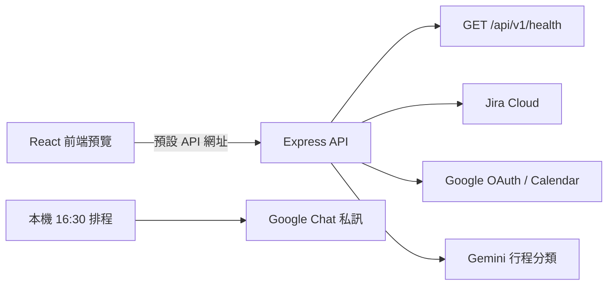
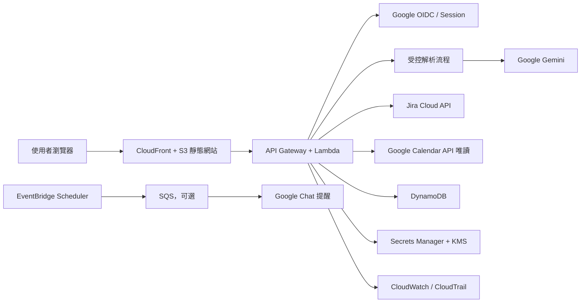

# NL-agent

NL-agent 是一個整合工程工作流程的網站。本期以 Jira 工時紀錄為核心：規劃讓使用者把 Google Calendar 工時建議與自然語言補登合併為同一份草稿，確認後再寫入 Jira。結案報告製作與 SOW 撰寫也會列在產品導覽中，目前仍是待開發項目。

目前儲存庫包含 NL-agent 前端與 Express 後端。Google OAuth、Calendar 讀取、AI 行程分類、Jira 連線與工時確認流程已在開發中；Google Chat 每日提醒可在本機後端啟用。提醒排程及 OAuth token 儲存目前是本機開發實作，尚未具備 AWS 多執行個體／Lambda 所需的持久儲存與雲端排程。

## 目標與設計原則

- 集中工程師常用的工作流程，先開發 Jira 工時紀錄模組，再逐步擴充其他功能。
- 支援兩種可併用的工時來源：Calendar 建議與自然語言手動補登，合併後由使用者檢視及確認。
- AI 負責解析文字並提供候選；後端規則負責身分、權限、工時防呆與寫入條件。
- 每筆工時都須經使用者明確確認；不確定的專案或票卡先交由使用者補充，不由模型猜測後寫入。
- 登入授權與 Calendar 唯讀授權分開，並只處理及保存完成工作所需的最少資料。

## 目前功能狀態

| 區域 | 目前狀態 |
| --- | --- |
| 首頁 | 工時 Dashboard 介面預覽，資料為靜態示意內容 |
| Jira 工時紀錄 | Calendar 行程建議、手動補登、草稿調整、Jira 配對與使用者確認流程 |
| 結案報告製作、SOW 撰寫 | 導覽與待開發頁面 |
| 後端 API | Express API，支援本機及 AWS Lambda API 部署 |
| 登入與外部整合 | Google 登入、Calendar OAuth、Jira OAuth／API、Gemini 行程分類與 Jira 配對、本機 Google Chat 提醒排程 |

## 技術架構

### 儲存庫目前包含



- **前端**：React 18、TypeScript、Vite、React Router。包含首頁、工時紀錄、結案報告及 SOW 頁面；工時頁提供 Calendar 行程示意、手動草稿、月曆與確認提示。
- **後端**：Node.js 22 以上、Express、TypeScript。以 `serverless-http` 將 Express app 包裝為 Lambda handler；目前只提供健康檢查 API。
- **部署起點**：`BackEnd/template.yaml` 是 AWS SAM 範本，配置 API Gateway HTTP API、Lambda 與 30 天 CloudWatch Logs 保存期。它只部署 API 基礎，尚未建立前端網站或外部整合。

### 規劃中的目標架構

以下為企劃中的後續架構，尚未全部建置：



模型只回傳符合固定 schema 的解析欄位與候選理由，不持有憑證，也不直接呼叫 Jira 寫入 API。後端應重新驗證使用者權限、票卡狀態、重複工時與冪等鍵；使用者確認後才新增或更新工時。排程提醒及 Calendar 匯入會依階段導入。

## 本機開發

需求：Node.js 22 以上及 npm。

### 啟動後端

```bash
cd BackEnd
npm ci
cp .env.example .env
npm run dev
```

後端預設監聽 `http://localhost:3000`。健康檢查：

```bash
curl http://localhost:3000/api/v1/health
```

`.env` 支援以下本機設定：

| 變數 | 預設值 | 說明 |
| --- | --- | --- |
| `APP_ENV` | `development` | 執行環境標籤 |
| `PORT` | `3000` | 本機 API 埠號 |
| `CORS_ORIGINS` | `http://localhost:5173` | 允許的瀏覽器來源，可用逗號分隔多個來源 |

### 啟動前端

在另一個終端機執行：

```bash
cd FrontEnd
npm ci
cp .env.example .env.local
npm run dev
```

Vite 預設網址為 `http://localhost:5173`。`VITE_API_BASE_URL` 預設為 `http://localhost:3000/api/v1`；Google Chat 通知的日期連結會開啟 `/#/worklogs?date=YYYY-MM-DD`。

其他前端指令：

```bash
npm run build
npm run lint
```

### Google Chat 每日工時提醒（本機開發）

此排程每天於 **Asia/Taipei 16:30** 執行。它即時讀取工程師已授權的 Google Calendar，使用現有分類器判斷行程，只在 Chat 私訊列出工作行程與預估時數；私人及待確認行程名稱不會被放進通知。訊息包含 NL-agent 當日頁面連結，工時仍須工程師在網站確認後才會送到 Jira。

1. 在 Google Cloud 同一個 Workspace 專案啟用 **Google Chat API**，建立 Google Chat App，設定為 HTTP endpoint，事件網址填公開 HTTPS 網址 `https://<後端網域>/api/v1/chat/events`。Google Chat 無法呼叫 `localhost`；本機測試需使用 HTTPS tunnel，正式環境使用已部署的 HTTPS API。
2. 在 Chat App 設定中開啟 App authentication，將 audience 設為上述 endpoint URL，並把同一個 App 的 service account JSON 以 Base64 編碼後填入 `GOOGLE_CHAT_SERVICE_ACCOUNT_JSON_BASE64`。此 service account 必須是該 Chat App 配置所使用的帳號，並可使用 `https://www.googleapis.com/auth/chat.bot` scope。
3. 設定 `GOOGLE_CHAT_APP_AUDIENCE` 為 Chat App 中配置的完全相同 audience（通常是 endpoint URL），並將 `DAILY_REMINDER_ENABLED=true`。
4. 確認 `FRONTEND_URL` 是工程師可瀏覽的 NL-agent 網址。開啟後端並讓它持續執行；本機排程只在後端程序運作時生效。
5. 每位工程師先用與 NL-agent／Calendar 相同的公司 Google 帳號連接 Google Calendar，再到 Google Chat 找到並開啟 NL-agent App 私訊，傳送任意訊息完成連結。若 Calendar 在新增 Chat 提醒功能前已連線，請重新連接一次以保存帳號 Email。
6. 16:30 後檢查 Chat 私訊。`GET /api/v1/chat/status` 可用於檢查登入使用者是否已啟用提醒並連結 DM。

Base64 編碼方式（macOS）：

```bash
base64 -i /path/to/chat-service-account.json | tr -d '\\n'
```

請將輸出貼到本機 `BackEnd/.env`，不要提交 `.env` 或 service account JSON。Google Chat DM 使用 Chat App 身分發送；工程師必須先開啟 App 私訊，且公司 Workspace 的 Chat App 管理政策須允許此 App。

**AWS 部署限制：**目前 SAM 範本部署的是無狀態 API Lambda，而 Calendar refresh token、Chat space 對照及去重日期存在本機加密檔案；每日排程亦由本機 Node 程序執行。直接部署到 Lambda 不會啟動 16:30 排程，也無法跨執行個體保留使用者連線。正式 AWS 版本需先把 token／Chat 對照改存 DynamoDB（建議 KMS 加密），再用 EventBridge Scheduler 以 `Asia/Taipei` 每天觸發一個提醒 Lambda；這是後續工作，不能只靠上述 env 變數完成。

## 路由

| 路徑 | 頁面 |
| --- | --- |
| `/` | 首頁工時總覽 |
| `/worklogs` | Jira 工時紀錄預覽 |
| `/reports` | 結案報告製作（待開發） |
| `/sow` | SOW 撰寫（待開發） |

前端使用 hash router，部署在靜態網站時可透過 `/#/worklogs` 等網址開啟頁面。

## 主要目錄

```text
BackEnd/
  src/app.ts            Express app、CORS 與請求日誌
  src/routes/api.ts     API 路由（目前只有健康檢查）
  src/local.ts          本機 HTTP server 入口
  src/lambda.ts         AWS Lambda handler
  template.yaml         AWS SAM API 部署範本
FrontEnd/
  src/view/             頁面與互動預覽
  src/router/           前端路由
  src/style/            全域與頁面樣式
```

## 後續開發方向

企劃規劃的開發順序如下，實際範圍仍須依 Jira、Google Workspace 與 AWS 管理政策確認：

1. 確認 Jira 授權方式、公司 Google Workspace 政策、工時規則、假日資料與資料保存期限。
2. 建置公司 Google 帳號登入、session 與使用者設定。
3. 串接 Jira 專案／票卡查詢、自然語言草稿、重複與狀態檢查，以及明確確認後的新增／更新流程。
4. 連接 Jira 工時資料，完成 Dashboard、月曆與工作日提醒。
5. 以增量授權加入 Calendar 唯讀建議，並規劃每週 Google Chat 提醒。
6. 依需求定義並開發結案報告製作及 SOW 撰寫。

## 安全與隱私

- 不要提交 `.env`、OAuth token、API key 或 webhook URL；請使用服務的機密管理機制保管正式憑證。
- 前端環境變數會打包給瀏覽器，禁止放入任何秘密值。
- 正式流程應驗證 Google OIDC state、nonce、issuer、audience 與 token 有效期限，並使用安全 session cookie 及 CSRF 防護。
- Calendar 使用獨立的唯讀授權；私人或低信心事件不應自動建立工時，並應避免長期保存不必要的事件描述。
- AI 輸出必須視為未驗證輸入。所有 Jira 權限、票卡狀態、重複判斷及寫入條件都要由後端檢查。
- 新增或更新 Jira worklog 前須再次驗證並取得使用者確認，使用冪等處理避免重試造成重複紀錄。

## 部署

後端目前提供 AWS SAM 範本。使用 AWS SAM CLI 在 `BackEnd/` 執行建置與部署；部署前需將 `AllowedOrigins` 設定為實際前端網站來源。範本不會建立前端 CloudFront/S3、Google 登入、Jira／Calendar 整合或資料庫，因此目前屬於 API 部署起點，不是完整產品部署。

## 授權

此專案目前未在程式碼中指定開源授權。若要公開供他人使用或修改，請先選擇並新增適合的 LICENSE。
